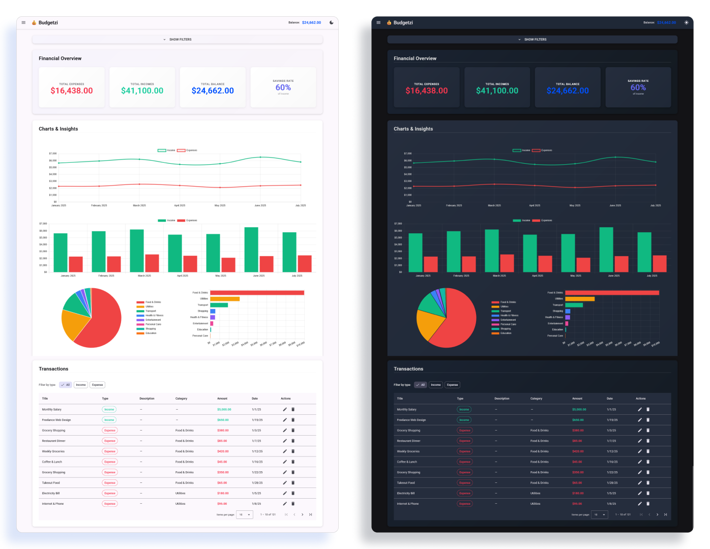

# Budgetzi - Simple Budget Tracker 💰

A simple **Angular + Angular Material** project that helps track expenses and income, while showcasing core Angular features.

## Tools & technologies


## Demo - Overview


## Features

- **SSR (Server-Side Rendering)** with @angular/platform-server for improved SEO and initial page load performance
- **Dynamic SEO** with Title, Meta tags, Open Graph, and canonical link management
- **Lazy-loaded feature modules** (dashboard, transactions, charts, data-management) with automatic code-splitting
- **Managing transactions** (income & expenses): reading, adding, editing, and deleting via a **reactive form** and **Angular Material table**
- **Dashboard** with total income, total expenses, and balance KPIs, updated automatically based on filters and state changes
- **Filtering** by transaction type, category, and date range, fully **integrated with NgRx** for consistent state management
- Data visualizations (line, pie, bar, and comparison charts) powered by **ng2-charts / Chart.js** for trends and category insights
- **CSV import/export** and a dedicated data management screen for loading sample data, handling backups, and managing stored transactions
- **Light/dark theme** support
- **NgRx setup** with **actions**, **reducers**, **selectors**, and **effects**, backed by a modular, standalone component architecture
- **Feature-centric architecture** with barrel exports for clean imports and scalability
- **Centralized utilities library** with reusable transaction and date formatting helpers
- **Refactored transaction table** with separated cell components for cleaner, more maintainable code

## Project Architecture

The project follows a modern, scalable Angular 20+ architecture:

- **SSR-Ready**: Server-side rendering with Express and @angular/platform-server for SEO optimization
- **Feature-Based**: Organized into self-contained features (dashboard, transactions, charts, data-management) with barrel exports
- **State Management**: NgRx store moved to feature folders for better encapsulation and scalability
- **Lazy-Loading**: Feature modules load on-demand with automatic code-splitting (verified in build output)
- **Shared Utilities**: Centralized `lib/utils` with transaction and date formatting helpers (DRY principle)
- **Services Barrel**: Clean exports of SeoService, ThemeService, and ChartColorsService
- **Types Organization**: Centralized type definitions with barrel exports for easy imports

## Next Steps

Future improvements planned:

- Fix remaining **responsiveness issues** across different screen sizes
- Categories management
- Data management insights
- Monthly rollups, forecasting
- Deployment

## Getting Started

```bash
git clone https://github.com/nataliaprazmo/budgetzi.git
cd budgetzi
npm install
ng serve -o
```

The app will run on [`http://localhost:4200/`](http://localhost:4200/)

## Building for SSR

### Development Build

```bash
npm start
```

### Production Build (Client + Server)

```bash
npm run build:ssr
```

### Build Only Client

```bash
npm run build:client
```

### Build Only Server

```bash
npm run build:server
```

### Serve SSR Application

```bash
npm run serve:ssr
```

## CSV Import Format Example

Sample data can be found in:
`budget-tracker/src/app/data/sample-data.ts`

### CSV structure

```csv
id,title,amount,date,type
```

### Example row

```csv
1,Monthly Salary,5000,2025-01-01T00:00:00.000Z,income
```

## What I learned

This is my private project created to learn and understand Angular better, especially its modern features and patterns - with a strong focus on NgRx Store and performance optimization.

Throughout the development of Budgetzi, I gained practical experience with:

- **Server-Side Rendering (SSR)** with @angular/platform-server for SEO and initial page load optimization
- **Dynamic SEO management** with meta tags, Open Graph, and canonical links
- **Feature-based architecture** with barrel imports for clean code organization and scalability
- **Lazy-loading and code-splitting** for improved production bundle performance
- **NgRx actions, reducers, selectors, and effects** to manage state in a predictable way, organized per feature
- **Reusable utilities** library to eliminate code duplication across components
- **Angular Material** components to build polished UI layouts
- **Reactive forms** and **CSV import/export** with data parsing and transformation
- **Standalone components** with modern Angular 20+ Application API

---


